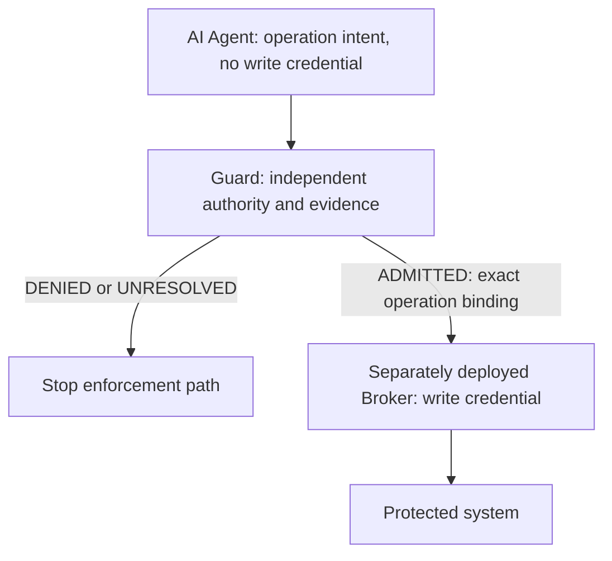

# Minimal architecture — Technical Preview

This is the intended qualified enforcement deployment. The package demo uses a simulated in-process Broker. A process boundary and credential isolation require separately deployed infrastructure; a diagram or an ADMITTED result does not establish either property. Shadow observes existing operations, never invokes the Guard Broker and does not prevent writes through other paths.

The trusted operator controls identity, policy, providers, exact mutation, evidence and Broker deployment. The Agent must not control those inputs or hold a bypass credential.
