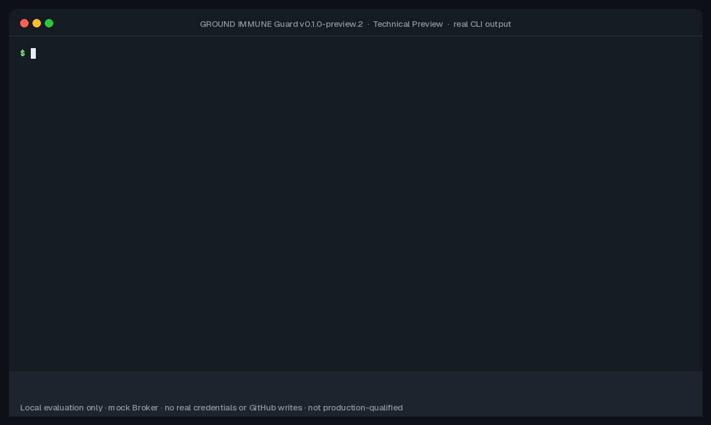
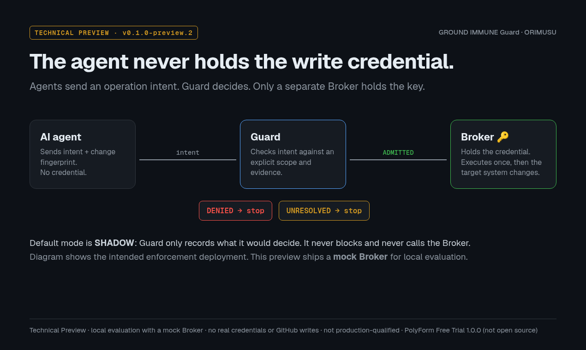

# GROUND IMMUNE Guard — Technical Preview

**Agent operations get a verdict, never a silent allow.**



Coding agents and automations increasingly push commits, edit files and call APIs with *your* token. If the agent holds the credential, a bug, a bad plan or a prompt injection can use it too.

Guard checks an agent's proposed operation against an explicit scope and required evidence, and returns a verdict:

| Decision | Meaning | Executes? |
|---|---|---|
| ADMITTED | Inside the configured scope, required evidence present | Yes, once, via the Broker (in explicitly enabled Limited Blocking) |
| DENIED | Outside the configured scope/policy | No |
| UNRESOLVED | Evidence missing, stale or inconsistent — never guessed as "allow" | No |

**Default is SHADOW:** Guard only records what it *would* decide; it never blocks and never calls the Guard Broker.

In explicitly enabled Limited Blocking, only an **ADMITTED** operation is handed to a separate **Broker**. The agent must not own the write credential or configure its own authority. This preview ships a *simulated* Broker, so it does not demonstrate physical credential isolation.



```text
AI Agent / Automation → operation intent → Guard
                                          ├─ DENIED → STOP
                                          ├─ UNRESOLVED → STOP
                                          └─ ADMITTED → Broker → Protected System
                                                       credential holder
```

The diagram shows explicitly enabled enforcement. In the default **SHADOW** mode Guard observes the customer's existing operation, does not block it and never calls the Guard Broker. DENIED (outside the configured authority) and UNRESOLVED (the basis for a safe decision is missing) never execute through the enforcement path.

## What this is

- A **Technical Preview** of a local scope check for AI-agent operations.
- A three-valued verdict: **ADMITTED**, **DENIED**, or **UNRESOLVED**. If evidence is missing, the answer is UNRESOLVED, never a silent allow.
- **SHADOW** by default (observe only). **LIMITED_BLOCKING** is an explicit opt-in that uses a local simulated Broker.
- In LIMITED_BLOCKING, if the operation changes after admission, **preview Broker binding** stops it (`TARGET_CHANGED`; the trusted Broker function is not run). That is a property of this preview's Broker bind, not a claim about unpublished systems.
- Licensed under the **Apache License 2.0**.

## What this is not

- Not a production-qualified security product, and not a demonstration of real-world hostile performance.
- Not a dedicated Broker host, not a credential-provisioning service, and not a real GitHub write executor. No real credentials are used.
- Not a claim of physical or OS-level credential isolation. In-process binding is not process or OS isolation.
- **Full IMMUNE is not in this repository.** Recovery, Governance and Adaptive layers of the broader unpublished system are not included, not activated by this preview, and not implied by installing the package.
- This repository is documentation, examples, packaging scripts and release records. The installable package ships a readable ESM build in `dist/`. The original TypeScript sources used to produce that build are not in this repository.

> **Technical Preview — read before use.** For local evaluation only. Ships a *simulated* Broker: no Broker host, no real credentials, no real GitHub write executor; not production-qualified. See [Limitations](docs/LIMITATIONS.md).

**Who it's for:** teams letting AI agents or bots write to GitHub or internal systems who want an authorization boundary they control, and who want to evaluate this preview and give feedback.

## Try it (no account, no credential, no network after download)

Requires Node.js 22 or later and npm (tested on Node 22.23.4 / npm 10.9.9 and Node 24.22.1 / npm 11.21.1, Linux). Run it in a **new, empty directory**.

The commands below are for the forthcoming **0.1.0-preview.3** package (same runtime intent as preview.2, with this repository's Apache-2.0 docs and license). Replace the placeholders before publication.

```sh
mkdir guard-try && cd guard-try
npm init -y >/dev/null    # makes this directory the npm project root (see note below)
curl -LO https://github.com/ORIMUSU/ground-immune-guard/releases/download/v0.1.0-preview.3/ground-immune-guard-0.1.0-preview.3.tgz
# Compare with SHA256SUMS / the release notes. macOS: shasum -a 256 …
echo "8b8e0ce3a546f623be88e69d857402d4c7cc2e68596b51cffd58e021c975067d  ground-immune-guard-0.1.0-preview.3.tgz" | sha256sum -c -
npm install --offline --ignore-scripts ./ground-immune-guard-0.1.0-preview.3.tgz

./node_modules/.bin/guard init ./blocking --limited      # local simulated Broker, no credential
./node_modules/.bin/guard protect ./blocking allowed     # ADMITTED  -> executes once           (exit 0)
./node_modules/.bin/guard protect ./blocking allowed     # replay    -> UNRESOLVED / DECISION_REUSED (exit 4)
./node_modules/.bin/guard protect ./blocking denied      # DENIED    -> OUT_OF_SCOPE, not executed  (exit 3)
./node_modules/.bin/guard protect ./blocking unresolved  # UNRESOLVED -> EVIDENCE_MISSING, not executed (exit 4)
./node_modules/.bin/guard verify ./blocking
```

Until preview.3 is published, the last frozen runtime is `0.1.0-preview.2` (SHA-256 `7b8b6bb7a2409e12cf2d7396089e059f728bd4b94a9dd5186aafef4f1d8bb99d`). That tarball still embeds the earlier PolyForm Free Trial license text. Do not treat it as the Apache-2.0 package.

Then try the default observe-only mode: `./node_modules/.bin/guard init ./shadow` and the same `protect` calls against `./shadow` — the decisions are reported with `outcome: OBSERVED`, nothing executes, and every verdict exits 0 (add `--fail-on-verdict` to get 3/4 in SHADOW, e.g. for a CI check). Output formats, `status` and exit codes are explained in [docs/EXPLAIN.md](docs/EXPLAIN.md).

To see post-admission substitution stopped by preview Broker binding, copy `examples/tamper-after-approval.mjs` into the same project and run `node tamper-after-approval.mjs` (LIMITED_BLOCKING only; default SHADOW does not exercise this path).

> **Why `npm init -y`?** Without a `package.json` in the current directory, npm installs into the nearest parent directory that has a `package.json` or `node_modules`. `./node_modules/.bin/guard` is then missing (exit 127). To add Guard to an existing project instead, run the `npm install` line from that project's root.

These commands use local, non-production authority and a simulated Broker; no credential or network transport is created. Follow [Quickstart](QUICKSTART.md) for JavaScript/TypeScript, and [GitHub](docs/GITHUB.md) for metadata mapping and the separate deployment qualification required before enforcement.

## Preview boundaries

- **Included:** intent evaluation, scope binding, local evidence, a local CLI, GitHub metadata mapping, and preview Broker binding that rejects a changed operation after admission (LIMITED_BLOCKING).
- **Not included:** a dedicated Broker host, credential provisioning, a real GitHub write transport, and the Recovery, Governance and Adaptive layers of Full IMMUNE.
- **No isolation claim:** the package does not establish physical credential isolation, and in-process binding is not process or OS isolation. A trusted host must own policy, providers, evidence and execution. Separate, later non-production cross-UID evidence ([Verification](docs/VERIFICATION.md)) does not qualify the package for production enforcement.

Read [Security Model](docs/SECURITY-MODEL.md), [Threat Model](docs/THREAT-MODEL.md), [Limitations](docs/LIMITATIONS.md) and [Data Handling](docs/PRIVACY.md). [API](docs/API.md) is a preview surface, not a promise of permanent compatibility.

## Where this is going

Guard is the published entry point. Full IMMUNE, a broader unpublished system, is not in this repository. That system contains separate Recovery, Governance and Adaptive mechanisms. They address authority lifecycle, incident and requirement evidence, independent verification, delegated promotion and recovery controls, and each needs its own trust roots, policies, evidence contracts and validation. See [Beyond the default Guard](docs/ADVANCED.md). Nothing in this preview activates those layers.

In the intended enforcement deployment, a separately deployed Broker on a dedicated credential-holding host is the only component that holds the write credential; it receives only ADMITTED operations, and decisions and results are kept as local hash-chained evidence. This package ships only a simulated in-process Broker, and physical qualification of that deployment is not yet verified.

A historical local baseline ran 430 Full IMMUNE tests ([Metrics](docs/METRICS.md)); that is evidence of regression coverage, not of real hostile-production performance. None of it has been demonstrated in production.

## Contact

Security reports: **security@orimusu.com**; see [reporting policy](SECURITY.md). Do not file sensitive vulnerability details in public issues.

Questions, feedback and Shadow Pilot requests: open a [GitHub Discussion](https://github.com/ORIMUSU/ground-immune-guard/discussions) once Discussions are enabled, or email **immune@orimusu.com**. Start a pilot with one narrowly scoped operation and measure setup friction, decisions and latency before considering enforcement.

## Contributing

Please read [CONTRIBUTING](CONTRIBUTING.md) and the [Code of Conduct](CODE_OF_CONDUCT.md) before opening an issue or pull request. A short [roadmap](ROADMAP.md) states direction without promising dates or features.

## License

This Technical Preview is licensed under the **Apache License, Version 2.0**. See [LICENSE](LICENSE) and [NOTICE](NOTICE). This summary is for convenience and is not legal advice.

- You may use, modify, and redistribute the Work under the terms of Apache-2.0, including for commercial purposes.
- A patent license is included, subject to the patent-retaliation clause in the License.
- There is no evaluation-period limit and no "not open source" restriction in this license.
- This repository does not currently include the original TypeScript sources of the installable package; the package ships readable ESM in `dist/` inside the release tarball. Third-party components remain under their own terms; see `THIRD-PARTY-NOTICES.txt`.

The approved preview distribution route is a public GitHub repository plus a GitHub Release containing the frozen tarball. npm registry publication is not part of this preview. Integrity is published through `SHA256SUMS` and `sbom.json`; the preview is **not cryptographically signed or attested**.

## What this repository contains

This repository contains reviewed documentation, examples, packaging scripts and community files. Installable tarballs are attached to GitHub Releases (see `https://github.com/ORIMUSU/ground-immune-guard/releases` once published) and their SHA-256 digests are listed in `SHA256SUMS`. It contains no history or source from the private development repository, no private host evidence and no deployment credentials.

See [Verification](docs/VERIFICATION.md), [Architecture](docs/ARCHITECTURE.md), [Changelog](CHANGELOG.md), `release-manifest.json`, `SHA256SUMS` and `sbom.json`.

[Advanced capabilities](docs/ADVANCED.md) are separate from the default Guard preview and are not in this repository.

Developed by **Shunsaku Yasutake** at ORIMUSU Inc.
